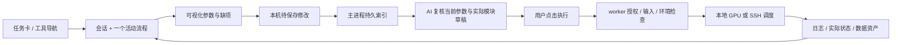

# Studio 实现审查与三轮迭代（2026-10-17）

> 历史记录：本文描述 2026-10-17 当时的实现与文件路径。v1.0 重组后部分路径已迁移（例如共享流程规则进入 `contracts/`/`backend/main/`），文中旧引用仅保留历史语义，不代表当前所有者。

## 结论与交互目标

0.6.1 的主要问题不是模型不会设计计算，而是账户、app server、worker、MCP 与本地流程索引的连接生命周期没有对齐；草稿保存依赖这条链，界面却只有一个“已连接”。手工参数保存也只有组件内存队列，异常后无法可靠恢复。

现在的用户路径为：选择任务模板或描述目标 → 开启规划 → 同一会话形成一个计算流程 → 展开红点步骤补参数与文件 → AI 复核同一版本 → 用户点击执行 → worker 验证、调度与记录实际状态。已有流程后可关闭规划开关继续自然语言修改；普通聊天不弹计算页面。没有实际模块输入或缺少科学条件时不开放执行。

参考 [LangGraph Studio](https://docs.langchain.com/langsmith/studio) 的图与聊天分工、线程恢复，以及 [n8n 工具人工审阅](https://docs.n8n.io/build/integrate-ai/ai-examples/human-in-the-loop-for-tools.md) 的明确参数与动作确认。采用这些交互原则，没有替换现有科学计算后端，也没有照搬其云端运行机制。app server 接口按[官方文档](https://learn.chatgpt.com/docs/app-server)及本机固定协议实际验证。

## 从界面到执行的检查

| 层 | 检查点与代码 | 结果 / 改进 |
| --- | --- | --- |
| 主进程 / renderer | main.mjs、preload.cjs、security.mjs；禁用 renderer Node，校验 sender / RPC / 文件授权 | 保持权限边界；新增接口仅返回脱敏的工具状态，不能修改项目授权 |
| 账户 / 服务商 | codex.mjs、agent-hub.mjs、acp.mjs、ProviderLogin.tsx | 修复账户先初始化导致工具缺失、账户观察请求竞争连接；活动回复不能被隐式重连或上下文修改打断 |
| worker / MCP | worker.mjs、bootstrap.py、relay.py、server.py | 真实工具目录与 present_task 就绪检查；连接单飞、旧 relay 身份隔离；本机 Python 请求绕过环境 HTTP 代理；资源目录空响应减少错误噪声 |
| 项目与会话 | task-records.mjs、Catalog、Agent / App | 一会话一个默认活动流程，provider/thread 校验；进程重建后恢复 thread；重开聊天不再展示内部 workspace JSON 和模式指令 |
| 参数编辑 | task-fields、draft-outbox、AgentTaskPage | 序号确认、失败持久恢复；搜索、定位缺项；已有参数不因 AI 旧响应被覆盖；绿点只代表参数齐全 |
| 复核与执行 | review-state、task-execution、RunReview | 复核与参数 / 模块修订绑定；执行前再次核对；未知提交不重提；恢复中的 validating / submitting 也提供核对入口并锁定编辑 |
| 队列与日志 | Service / Store / runner / ClusterRunPage | worker 独立持久化、输入哈希、进程身份与退出收据；慢刷新不再每 2.5 秒产生一组重叠请求，也不会因序号不断变更而一直不展示结果 |
| 科学适配器 | adapters.py / science_checks / cluster preflight | 输入契约、序列化 Bias 检查与计算节点预检分开；普通输入检查 passed 不等于科学计算通过；本轮不修改兄弟引擎源码 |
| SSH / 凭据 | existing-ssh、ssh-endpoint、cluster.py / CredentialVault | 保留显式用户名、认证引用和已有登记；本轮只核对保留与接口，不提交集群任务，不公开连接信息 |
| 布局 / 操作反馈 | task-flow.css、ToolActivity、ViewBoundary | 五阶段、明确下一步与禁用原因；成功 / 失败 / 运行中操作卡；原始详情折叠，错误不再显示成功勾选；主进程启动失败保留日志并提示 |
| 安装 / 发布 | installation manifest、README、Git、包内容比对 | 版本同步到 0.9.0；旧测试数据不做无尽迁移，SSH / 授权 / 真实作业受保护；最终包单独验收 |

## 三轮实质改动

1. [0.7.0](v0.7.md)：修复账户先连接导致的 MCP 缺失，增加连接上下文识别、工具就绪门槛和重连后的会话恢复。原生工具目录为 26 项，真实模型保存草稿通过。
2. [0.8.0](v0.8.md)：五阶段可视化审阅、缺项搜索与定位、执行原因、持久化参数 outbox；覆盖失败后重开与 A→B→A 编辑竞争。
3. [0.9.0](v0.9.md)：账户刷新并发修复、工具操作卡与历史清洁、断线修复及原流程延续、慢刷新合并、验证语义纠正、未知状态恢复和最终打包验收。

## 功能范围审计

shared/workflows.mjs 的实际登记为七类工具。MD、NEP / HotPP、pyGAS、资产、Viewer 与队列标为 partial；主动学习为 planned。NEB、主动学习选择 / DFT 复核步骤明确标为待接入。TorchNEP 独立适配、完整主动学习闭环、外部 DFT 服务及 OVITO 嵌入没有被这轮界面升级变成可执行能力。现有结构预览是 Three.js 分帧预览。

本轮完成的是连接、保存、审阅、恢复与交互质量的三轮改进；科学引擎生产适用性、长程收敛、真实集群运行、全新账户及全新机器安装不能用界面测试替代。大前端 bundle 的构建警告仍存在，尚未完成按模块延迟加载；不影响已验证的启动和流程操作，不将其写成已解决。

最终结果和原始证据索引见 [0.9.0](v0.9.md)。两轮中间版本是独立源码提交，没有为未单独检查的安装包创建发布标签。
