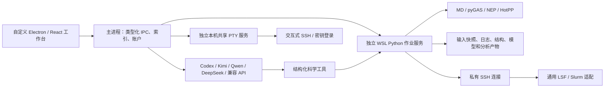

# GPU Sampling Studio 开发者文档

开发版本以根目录 `package.json` 为准。各代具体变更和验证结果见 [CHANGELOG](../../CHANGELOG.md) 与 [当前版本记录](../v1.0.md)；未完成工作见 [ROADMAP](ROADMAP.md)。历史记录中的通过只适用于其明确版本、输入和环境，不自动成为当前版本的新验收。

产品职责与工具契约见 [软件规范](../software-specification.md)，目标目录、迁移映射和分阶段验证见 [仓库重组方案](repository-reorganization.md)；当前在 `codex/v1.0` 分支实施，结果和未完成项见 [v1.0记录](../v1.0.md)。

## 产品与交互规则

共享终端是独立于科学作业服务的连接能力。人工将终端交给当前对话后，Agent 可直接使用该终端的三项 MCP 工具，无需再次请求共享或注册计算环境。桌面在 WSL 未连接时提供仅终端的端点；工具定义可发现不等于会话已授权。接管、关闭、换对话及服务商隔离由实际交接和上下文租约检查执行，科学文件授权和计算执行门不从终端交接中继承。见[共享终端设计](shared-terminal.md)。

核心路径是：自然语言描述目标 → Agent 填写当前会话的科学流程 → 用户审阅和微调 → 配置部署 → 用户执行 → 任务监视和结果分析。普通对话不自动创建流程；同一会话通常维护一个流程，只有用户明确要求才另建。

首页承载会话、项目分组、置顶和新建计算任务；技能库展示工具能力及其参与的任务；任务页展示规划、本地运行和集群记录。搜索、账号与 API、连接计算资源、设置和布局切换保持可发现。主要科学参数直接展示，原软件的默认值和细节参数按类别折叠；补充说明用提示框，缺项、真实错误和需要用户采取的动作保留可见。

任务导向卡片组合工具，但不强迫用户从零完成每个辅助步骤。已有结构、模型和数据集可以直接导入；主动学习、重新训练和额外分析按需要选择。CV 优先使用登记版本的 pyGAS 类库及参数，组合图和实际输入共同保存。自定义 CV 需先讨论定义和公式，再进入独立的实现与数值验证步骤；不能用原生手写偏置绕过已有 pyGAS 流程。

## 系统关系

模型推理与科学算力分别连接。渲染进程没有 Node、文件系统或凭据访问能力；所有特权操作经过主进程验证。桌面拥有项目/会话索引，worker 拥有权威运行状态。关闭桌面不取消已提交作业；状态未知时核对原作业，不能自动再次提交。

## 已开发能力与边界

“已实现”表示存在实际代码和对应接口，并不表示所有真实环境或每种参数组合均已验收。

| 模块 | 已实现 | 仍需独立完成或确认 |
| --- | --- | --- |
| 工作台 | 会话及项目分组、置顶、搜索、单页工作区、可调面板、深浅主题、字体字号、中英文、Agent 居中布局 | 本轮受影响布局及控件已实际复验；条件分支和完整离线聊天等见后续清单 |
| Agent | Codex app server、Kimi/Qwen ACP、DeepSeek 与 OpenAI 兼容 Chat Completions；全局账户入口、模型与 effort、自定义模型名/推理选项、会话恢复 | 新账户认证和各服务商的实际模型访问必须分别验证；兼容 API 不代表任意原生协议 |
| 科学流程 | 会话绑定、原流程续填、分层参数/文件、缺项定位、版本及迟到响应保护、审阅与部署分离 | 模型声称参数齐全不能代替实际文件检查或科学验证 |
| 传统 MD | `pydyn.md`、`gpumd.md`，日志、结果、取消及支持范围内的续算 | 环境显式登记；重启能力由引擎和输入决定 |
| 增强采样 | `pydyn.sampling`、`gpumd.sampling`，实际 pyGAS 来源绑定、构建/验证入口、CV/Bias 图与资产 | 有历史状态的方法须遵守各自恢复契约；显式 AOTI 不兼容时失败且不降级 |
| NEB | `gpumd.neb` 的 GPU-Sampling 原生路线 | PyDyn NEB 尚无可执行适配器；短例不证明势垒收敛 |
| pyGAS 与分析 | `pygas.build`、`bias.validate`、`pygas.reweight`、`pygas.opes-reweight`；类库参数、组合图、私有自定义 CV 库、分析输入与结果 | 所有 CV、任意模型、NPT 和自由能收敛不可能由通用短例证明 |
| 训练与评估 | `nep.train`、`nep.eval`、`nep.analyze`、`hotpp.train`、`hotpp.eval`、`hotpp.export` | TorchNEP 独立适配器待开发；数据集角色、标签和消费端模型格式仍须核对 |
| 主动学习 | 工具关系与计划入口 | NEPMaker、ActiveMiao 和外部 DFT 的执行闭环待接入 |
| 资产与 Viewer | 工作区复制/软链接导入、来源/哈希、文件预览、ASE 结构处理、Materials Project 密钥入口、Three.js 分帧预览 | MP 实际查询需要用户密钥；OVITO 集成、高级拼接/编辑和完整 DFT 请求流转待开发 |
| 计算资源 | 本地 WSL 独立 worker、原来源恢复、环境注册/发现、手动 SSH 用户名、已有连接导入、密钥或客户端默认认证、人工交互认证/可选转发 | 实际 MFA/隧道等按具体入口独立验收；连接成功不证明 GPU 或科学环境可用 |
| 调度器 | 通用 LSF/Slurm 配置、提交、监控、状态核对和结果回收代码；独立软件契约测试 | 本轮仅保留 SSH 连接方案；站点模板学习、具体队列/环境及真实提交验收已推迟，禁止继续实际探测 |
| 安装与启动 | one-prompt 安装文档、显式配置、独立环境/profile、安装收据和验收门；Windows 共用启动前置检查 | 线上仓库下载、全新机器/签名安装及所有科学模块自动安装不能宣称完成 |

## 运行状态与证据

运行状态为 `draft / validating / ready / queued / running / succeeded / failed / cancelled / unknown`，验证状态单独记录 `passed / failed / blocked / not_run`。草稿已保存、参数齐全、已复核、已准备、已提交、程序成功退出和科学正确是不同状态。

每次正式运行保留独立不可变输入、哈希、引擎和源码身份、环境、命令、日志、退出记录及实际产物。Bias 验证必须重新加载序列化产物，并使用真实目标结构、邻居、力和 virial 契约。禁止伪造作业状态、GPU 指标、模型访问或科学结果；显式选择 AOTI 时不能静默换后端。

## 可迁移配置与隐私

仓库保存通用代码、契约、公开技能、通用示例和开发文档；不得包含个人主机、账户、端口、队列、节点、密钥、私有输入和实际环境路径。`.studio/`、`release/`、`.env`、`.env.*` 和 `custom-cv-library/` 保持 Git 忽略；`.env.example` 可跟踪且只允许通用占位符。私有连接、测试环境、运行时收据和本地 skill overlay 留在忽略目录或系统私有存储中。

如果用户开始在原隔离验收配置中保存真实连接，该目录即按用户配置保护，不能继续视为可丢弃测试数据；后续构建须提供明确的同目录启动或审阅后的迁移入口，不清理连接、凭据、终端或运行状态。

当前工作树的清理不会改写 Git 历史。历史文档和验收脚本曾包含本机路径与环境信息，旧提交仍可恢复这些字节；对外分发采用精确当前源码树的新单根 Git 快照，使用通用作者且不包含旧对象历史、远程连接或 ignored 运行数据；原工作仓库历史保留本地。若未来公开原历史，仍须另行净化审阅。不得把当前树扫描通过表述为全部历史已清理。本轮不改写原历史、不设置远程仓库或推送。

统一计算资源管理器支持多条命名 WSL / SSH 连接，主入口覆盖侧栏、Agent、首页、环境页和设置。桌面连接配置与正式引擎环境、项目授权、调度器配置分别管理。

共享终端、交互式登录、密钥自动登录及私有认证的生命周期和权限边界见 [共享终端说明](shared-terminal.md)。本地终端验收与真实集群连接、环境探测和作业生命周期分别记账。

WSL 选择使用目标机器实际发行版；SSH 使用用户明确选择的来源和用户名，密码、私钥、OTP 由用户私下处理。不能把 SSH 设置权限扩大为软件安装、调度器探测或提交权限。后续站点适配先向用户索取少量成功模板及允许范围，再给出可审阅设置；模板是数据，不可直接执行。详见 [计算资源 skill](../../agent/builtin-skills/studio-compute-workflow/SKILL.md) 与 [可迁移技能](../portable-skills.md)。

安装后记录明确的软件位置、版本和能力，日常任务优先复用运行时登记，不重复读取整套安装说明。保留现有 SSH、凭据、环境、项目授权和真实运行状态；不切换兄弟科学仓库分支。1.0 前允许必要且有说明的开发数据破坏性升级，1.0 起要求兼容与版本化迁移。

## 开发与回归

按实际改动层选择验证：前端改动检查受影响组件和真实界面；后端改动检查受影响 API、状态、持久化与安全契约；跨层契约检查两端。界面改动、文案、版本递增和观察超时不触发完整软件套件或科学短例。科学执行或数值行为改变且契约测试不足时才运行受影响的有界真实案例。

修改外部程序的启动参数或环境后，先用不触及真实目标的只读版本查询核对实际客户端启动；固定文本夹具只验证传输与界面，不能代替真实客户端初始化。终端验收须分别记录键盘事件、桥接与真实PTY的证据，不能以有光标或固定输出推断可输入。

真实前端按钮验收、组件/模拟测试、直接 worker 测试与真实科学运行分别记账，不互相代替。保留首失败和修复后结果，使用隔离且 ignored 的 profile/worker 根目录。开发协调规则见 [development loop](skills/studio-development-loop/SKILL.md)。启动异常按 [Windows 启动故障记录](windows-startup-diagnostics.md) 排查，不重复启动失败上下文，不改 sandbox 或 ACL 掩盖问题。

每代更新 CHANGELOG 与版本文档，记录具体功能、验证范围及 `passed / failed / blocked / not_run`。提交前审阅准确的暂存字节及隐私；包核对通过后才能打本地标签，未经授权不推送。当前未完成项目统一在 [ROADMAP](ROADMAP.md) 跟踪。
